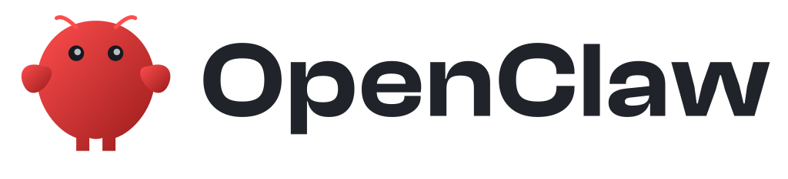
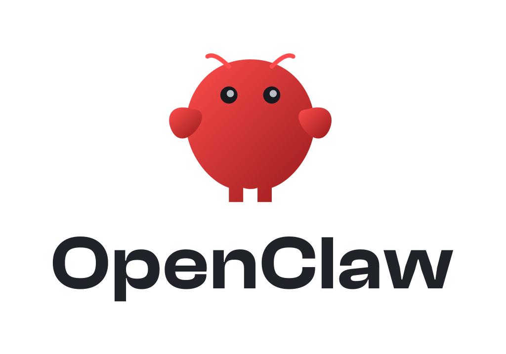
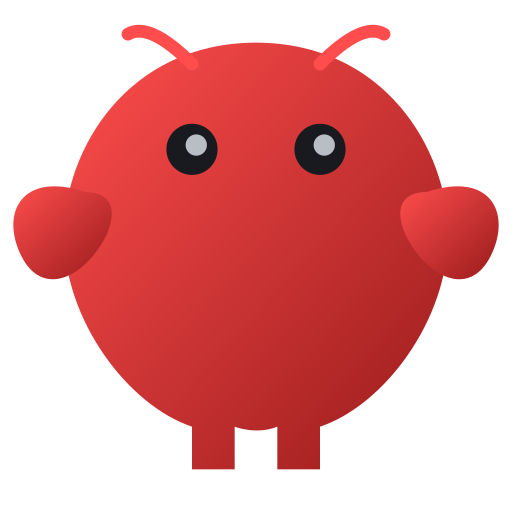

# OpenClaw brand kit

Browse and download the OpenClaw and OpenClaw Foundation artwork below.

This README is the single reference for OpenClaw and OpenClaw Foundation logo assets and usage.

All files have transparent backgrounds. Use dark text on light backgrounds and light or white text on dark backgrounds. SVG lettering is outlined; PNG sizes indicate width in pixels.

## OpenClaw horizontal

<picture>
  <source media="(prefers-color-scheme: dark)" srcset="openclaw/horizontal/openclaw-horizontal-clash600-1024w-light-text.png">
  
</picture>

| Variant | SVG | PNG |
| --- | --- | --- |
| Dark text | [SVG](openclaw/horizontal/openclaw-horizontal-clash600-dark-text.svg) | [512 px](openclaw/horizontal/openclaw-horizontal-clash600-512w-dark-text.png) · [1024 px](openclaw/horizontal/openclaw-horizontal-clash600-1024w-dark-text.png) · [4096 px](openclaw/horizontal/openclaw-horizontal-clash600-4096w-dark-text.png) |
| Light text | [SVG](openclaw/horizontal/openclaw-horizontal-clash600-light-text.svg) | [512 px](openclaw/horizontal/openclaw-horizontal-clash600-512w-light-text.png) · [1024 px](openclaw/horizontal/openclaw-horizontal-clash600-1024w-light-text.png) · [4096 px](openclaw/horizontal/openclaw-horizontal-clash600-4096w-light-text.png) |

## OpenClaw stacked

<picture>
  <source media="(prefers-color-scheme: dark)" srcset="openclaw/stacked/openclaw-stacked-clash600-1024w-light-text.png">
  
</picture>

| Variant | SVG | PNG |
| --- | --- | --- |
| Dark text | [SVG](openclaw/stacked/openclaw-stacked-clash600-dark-text.svg) | [512 px](openclaw/stacked/openclaw-stacked-clash600-512w-dark-text.png) · [1024 px](openclaw/stacked/openclaw-stacked-clash600-1024w-dark-text.png) · [4096 px](openclaw/stacked/openclaw-stacked-clash600-4096w-dark-text.png) |
| Light text | [SVG](openclaw/stacked/openclaw-stacked-clash600-light-text.svg) | [512 px](openclaw/stacked/openclaw-stacked-clash600-512w-light-text.png) · [1024 px](openclaw/stacked/openclaw-stacked-clash600-1024w-light-text.png) · [4096 px](openclaw/stacked/openclaw-stacked-clash600-4096w-light-text.png) |

## Mascot

| Variant | SVG | PNG |
| --- | --- | --- |
| Mascot | [SVG](openclaw/mascot/openclaw-mascot.svg) | [128 px](openclaw/mascot/openclaw-mascot-128w.png) · [512 px](openclaw/mascot/openclaw-mascot-512w.png) · [2048 px](openclaw/mascot/openclaw-mascot-2048w.png) |

## OpenClaw Foundation

<picture>
  <source media="(prefers-color-scheme: dark)" srcset="foundation/openclaw-foundation-white-text-1024w.png">
  
</picture>

| Variant | SVG | PNG |
| --- | --- | --- |
| Dark text | [SVG](foundation/openclaw-foundation-dark-text.svg) | [1024 px](foundation/openclaw-foundation-dark-text-1024w.png) · [2048 px](foundation/openclaw-foundation-dark-text-2048w.png) · [6000 px](foundation/openclaw-foundation-dark-text-6000w.png) |
| White text | [SVG](foundation/openclaw-foundation-white-text.svg) | [1024 px](foundation/openclaw-foundation-white-text-1024w.png) · [2048 px](foundation/openclaw-foundation-white-text-2048w.png) · [6000 px](foundation/openclaw-foundation-white-text-6000w.png) |
| Slate / dark text | [SVG](foundation/openclaw-foundation-slate-dark-text.svg) | [1024 px](foundation/openclaw-foundation-slate-1024w-dark-text.png) · [2048 px](foundation/openclaw-foundation-slate-2048w-dark-text.png) · [6000 px](foundation/openclaw-foundation-slate-6000w-dark-text.png) |
| Slate / light text | [SVG](foundation/openclaw-foundation-slate-light-text.svg) | [1024 px](foundation/openclaw-foundation-slate-1024w-light-text.png) · [2048 px](foundation/openclaw-foundation-slate-2048w-light-text.png) · [6000 px](foundation/openclaw-foundation-slate-6000w-light-text.png) |
